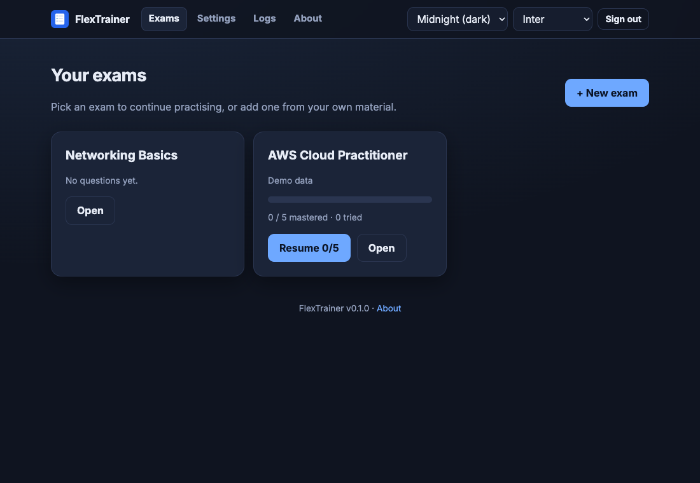
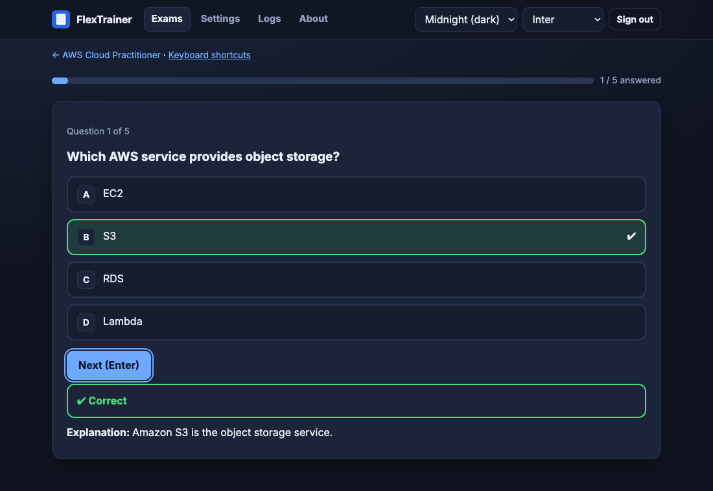
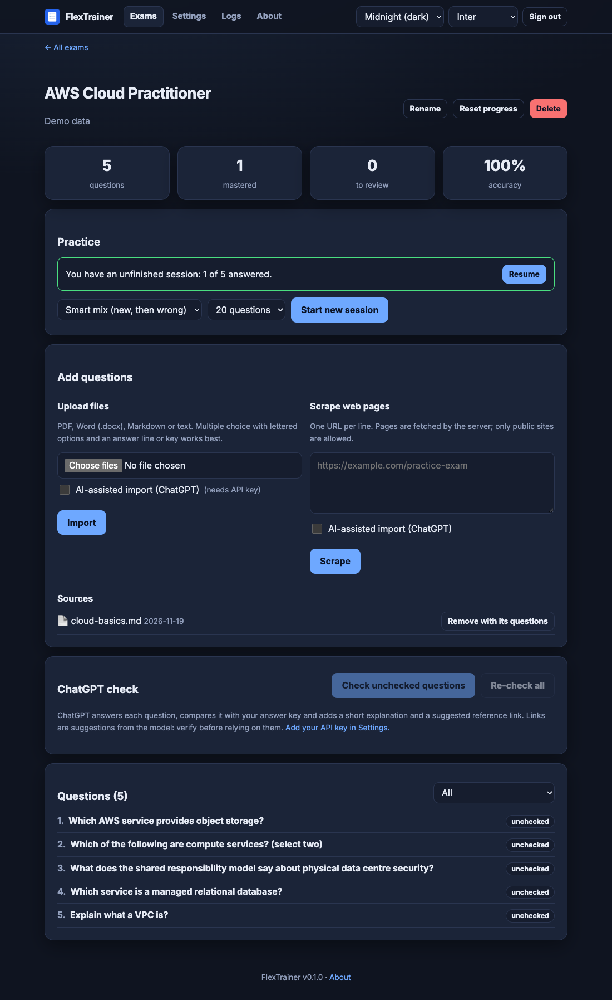
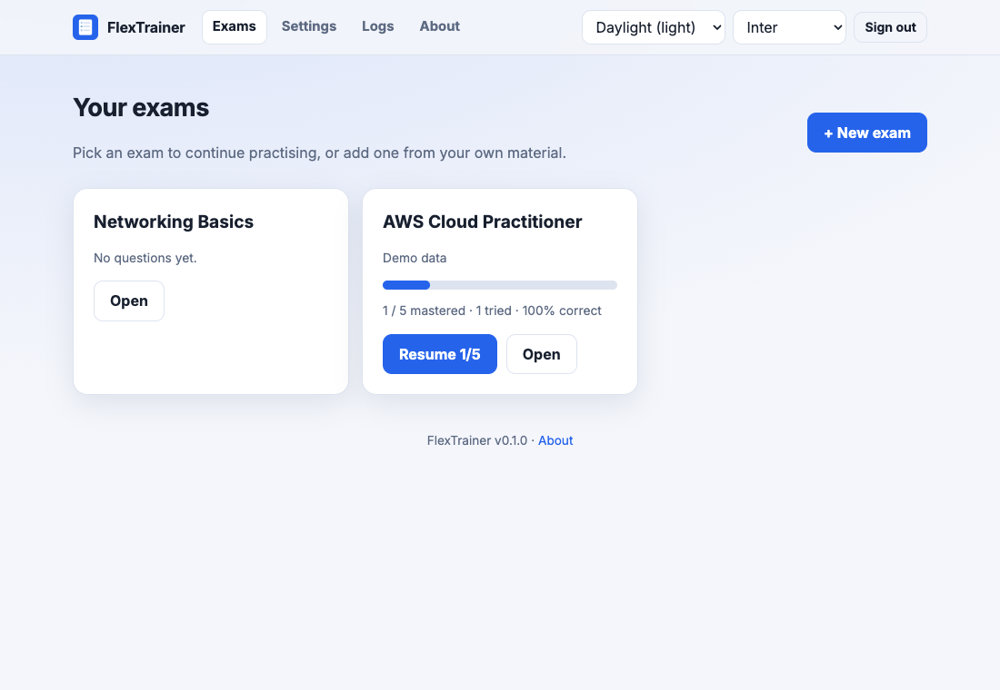

<p align="center"></p>

# FlexTrainer

Self-hosted exam trainer for your NAS. Upload PDF, Word or Markdown files with exam questions (or scrape a web page),
practise them with instant right/wrong feedback, keep your progress per exam and let ChatGPT check every question.
One container, one SQLite file, no external services required.

| Exams overview | Practice |
| --- | --- |
|  |  |
| **Exam page** | **Light theme** |
|  |  |

## Features
- **Main menu with one card per exam**: questions, mastered, to review, accuracy, and a *Resume* button.
- **Import**: PDF, Word (`.docx`, including auto-numbered A/B/C lists), Markdown and text. Recognises numbered questions,
  lettered options, `Answer:`/`Antwoord:` lines, explanations, markdown checkboxes and a trailing answer key.
  Pictures that belong to a question are imported with it (PDF, Word, Markdown, web pages). Duplicates are skipped. Optional **AI-assisted import** for material the parser cannot read.
  With a ChatGPT key, **multiple choice is generated from your examples** (open or numbered questions, study text);
  questions already written as multiple choice are kept as they are. If the parser finds no multiple choice at all,
  generation runs automatically.
- **Scraper**: paste URLs, the server fetches and converts the page (HTML, PDF or text) into questions. Public addresses
  only (SSRF protection).
- **Practice**: smart mix (new first, then wrong), unseen only, wrong only or all. The result (✔/✘) is shown the moment
  you submit. Multiple-select questions and open questions (reveal + self-grade) are supported. Sessions are saved and
  can be resumed any time.
- **ChatGPT check of every question**: compares ChatGPT's answer with your key, adds a short explanation and a
  *suggested* reference link, and supplies a key when your source has none. Disputed questions are flagged; one click
  adopts ChatGPT's answer. Links come from the model: verify them before relying on them.
- 5 themes (2 light, 3 dark, AA contrast), 5 bundled fonts and adjustable text size, responsive, installable PWA, keyboard shortcuts.
- Weekly backups (SQLite online backup), export, import/restore with safety copy.
- `/health` and `/ready`, structured logs with a log viewer, About page with changelog and update notice.

## Install

Default login after the first start: **`admin` / `admin`**. You are forced to change the password immediately.

### Unraid (one command)
Run on the Unraid terminal:
```bash
curl -fsSL https://raw.githubusercontent.com/jayvenco/flextrainer/main/scripts/install-unraid.sh | bash
```
It pulls `ghcr.io/jayvenco/flextrainer:latest`, creates the container with Unraid labels (icon, WebUI button), maps
`/mnt/user/appdata/flextrainer/data` to `/app/data` and uses host port **8822**. Override with e.g.
`HOST_PORT=9000 bash install-unraid.sh`. Alternatively add `unraid/flextrainer.xml` as a Community Applications /
user template. If the GHCR package is private, set `GHCR_USER` and `GHCR_TOKEN` for the script.

### Docker run
```bash
docker run -d --name flextrainer --restart unless-stopped -p 8822:8000 \
  -v /mnt/user/appdata/flextrainer/data:/app/data -e TZ=Europe/Amsterdam \
  ghcr.io/jayvenco/flextrainer:latest
```

### Docker Compose
```bash
cp .env.example .env   # optional
docker compose up --build
```
Open <http://localhost:8822>.

## Update
Pull the new image: on Unraid use **Docker tab → force update** (or re-run the install script). Everything lives in the
data volume, so the database, backups, logs and the session secret survive updates and container re-creation. The About
page shows a non-intrusive notice when a newer release exists (`UPDATE_CHECK=false` disables it).

## Configuration
All variables are optional; invalid values stop the container with a clear error. See [.env.example](.env.example).

| Variable | Default | Purpose |
| --- | --- | --- |
| `TZ`, `PUID`, `PGID` | `UTC`, `99`, `100` | Time zone and the user/group the app runs as |
| `OPENAI_API_KEY`, `OPENAI_MODEL`, `OPENAI_BASE_URL` | – , `gpt-4o-mini`, OpenAI | ChatGPT checks (key can also be set in Settings, stored encrypted) |
| `DEFAULT_THEME` | `midnight` | Theme of the first account |
| `BACKUP_ENABLED`, `BACKUP_KEEP` | `true`, `7` | Weekly backups and retention (also in Settings) |
| `BASE_URL` | empty | Sub-path behind a reverse proxy, e.g. `/flextrainer` |
| `COOKIE_SECURE` | `false` | Force Secure cookies (auto when the proxy sends `X-Forwarded-Proto: https`) |
| `ALLOW_PRIVATE_SCRAPE` | `false` | Let the scraper reach LAN addresses |
| `UPDATE_CHECK`, `LOG_LEVEL` | `true`, `INFO` | About-page update notice, log verbosity |

**Privacy:** with ChatGPT enabled, question text (and imported text for AI-assisted import) is sent to the API provider.
Without a key nothing leaves your server, apart from scraping the URLs you enter.

## Reverse proxy and HTTPS
The app honours `X-Forwarded-*` headers. Terminate TLS in your proxy and forward to port 8822 (or 8000 in-network).

**Nginx Proxy Manager:** add a Proxy Host → scheme `http`, forward host/port of the container, enable *Websockets
support* off (not needed), request an SSL certificate and tick *Force SSL*. Under *Advanced* add
`client_max_body_size 30m;` so uploads work.

**Traefik (compose labels):**
```yaml
labels:
  - traefik.enable=true
  - traefik.http.routers.flextrainer.rule=Host(`exam.example.com`)
  - traefik.http.routers.flextrainer.entrypoints=websecure
  - traefik.http.routers.flextrainer.tls.certresolver=letsencrypt
  - traefik.http.services.flextrainer.loadbalancer.server.port=8000
```
For a sub-path (`https://nas.example.com/flextrainer/`) set `BASE_URL=/flextrainer` and have the proxy keep the prefix.

## Backup
Automatic weekly backups go to `/app/data/backup` (last 7 kept, configurable in **Settings**). Settings also offers
*Create backup now*, list, download, *Export* and *Import / restore*; a `before-restore-…` safety copy is made before
every restore. Backups use SQLite's online backup API, so they are consistent while the app runs.

## API usage
FlexTrainer deliberately has **no public API** and no API tokens. Only `/health` and `/ready` are open (liveness and
database readiness). The internal UI endpoints are listed in [docs/api.md](docs/api.md).

## Tests
```bash
python3.12 -m venv .venv && ./.venv/bin/pip install -r requirements-dev.txt
./.venv/bin/ruff check app tests
./.venv/bin/python -m pytest -q
```
CI (`.github/workflows/ci.yml`) also builds the image and smoke-tests it: the container starts, `/health` is green and
the default login redirects to the forced password change. Screenshots: `scripts/screenshots.py` (Playwright, demo data).

## Project docs
[CHANGELOG](CHANGELOG.md) · [Architecture](docs/architecture.md) · [API](docs/api.md) · [CLAUDE.md](CLAUDE.md)

## Keyboard shortcuts (practice)
`1`–`8` or `A`–`H` select · `Enter` submit / next · `S` skip · `P` or `←` previous question · `R` reveal (open questions) · `Y`/`N` self-grade · `?` help
